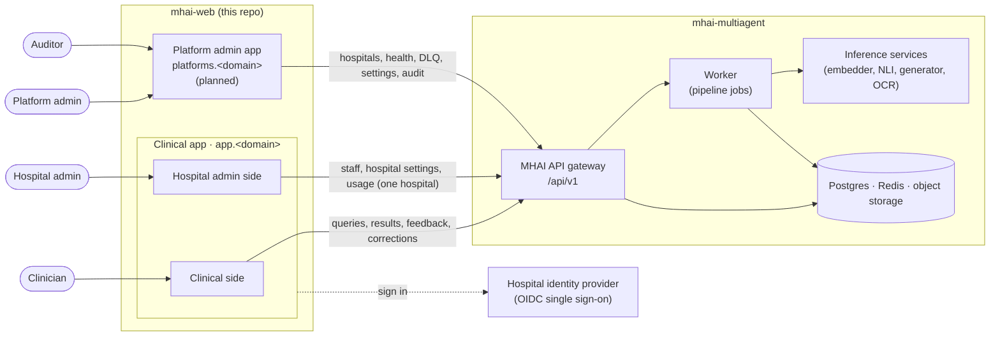
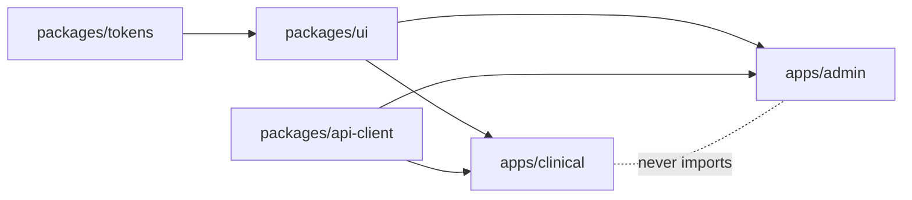
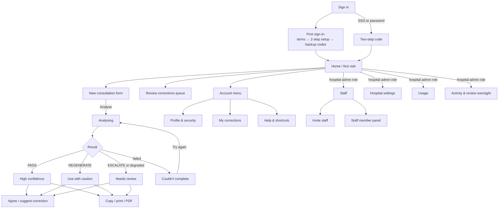
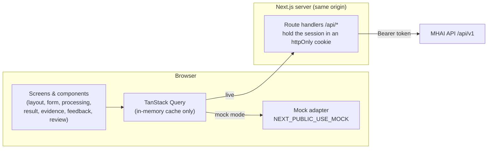
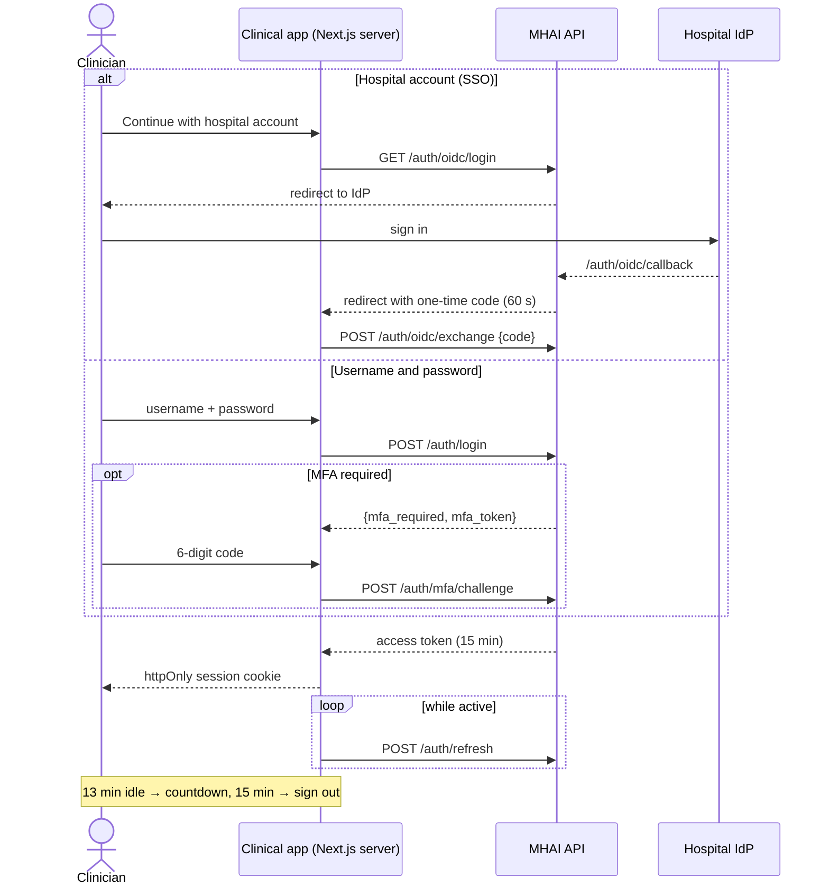
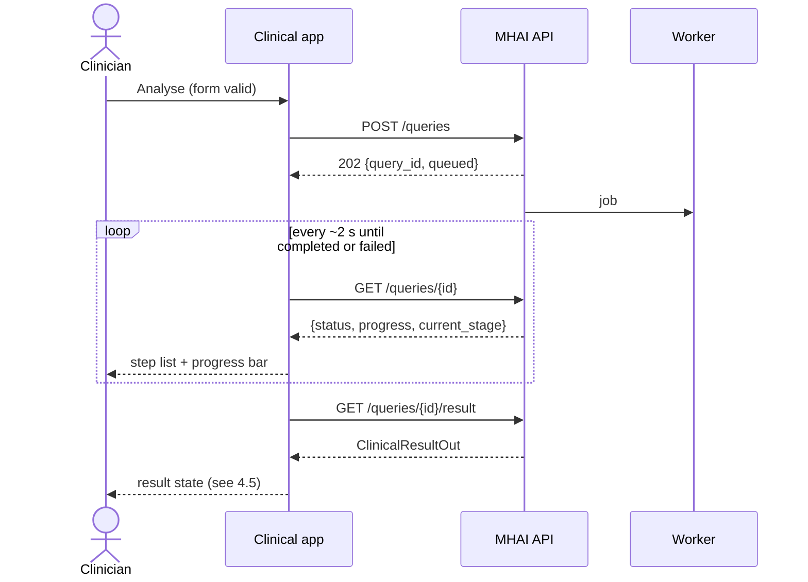
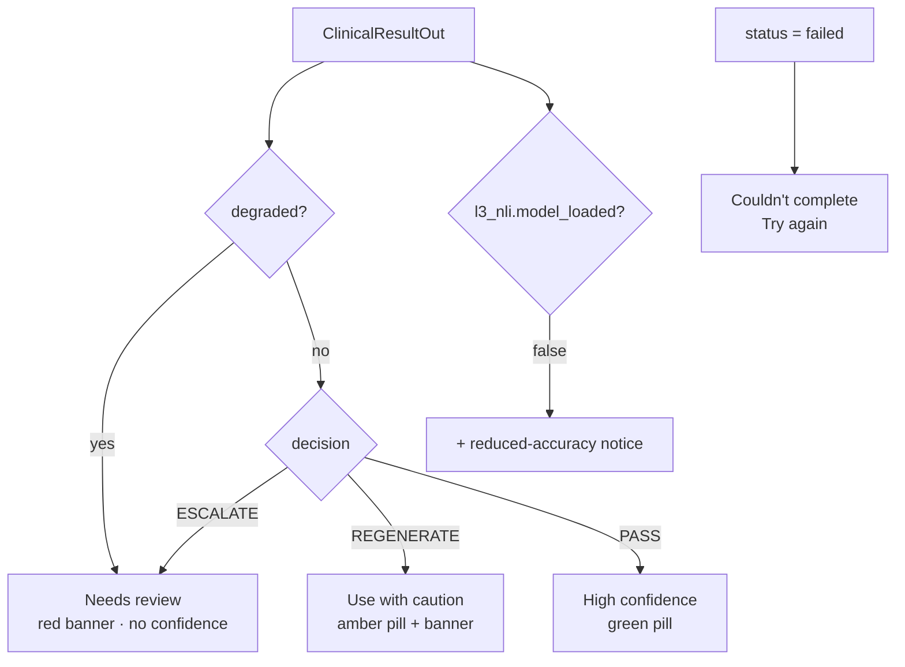
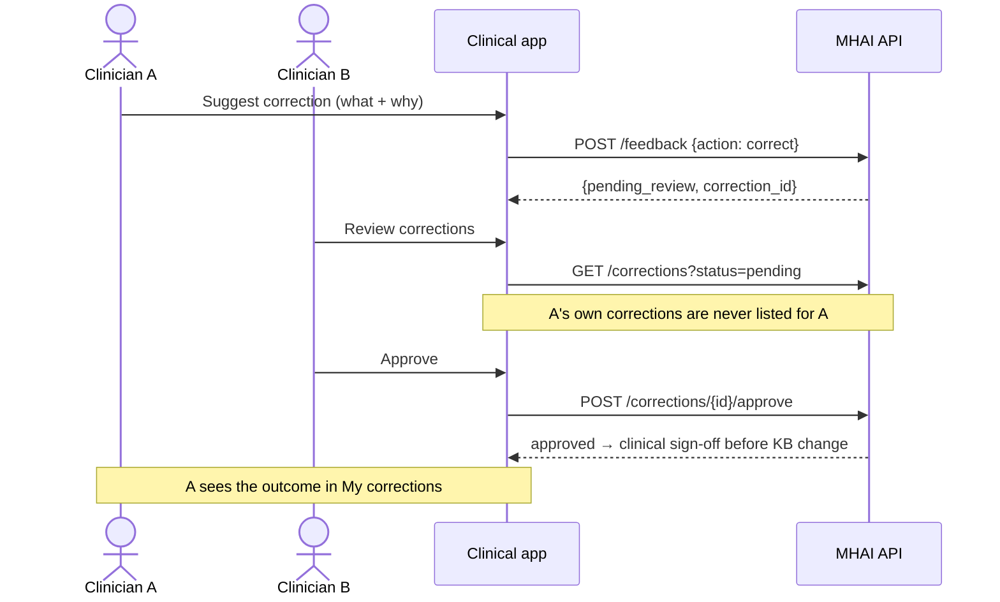
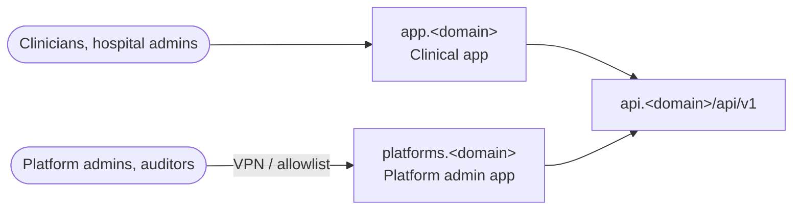

# Architecture

MHAI has **two frontend apps** and **three kinds of user**. Both apps talk
only to the MHAI API (`Measured-Health/mhai-multiagent`, base path
`/api/v1`).

| App                    | Who uses it                                         | What it does                                                                                                                                                                     | Status                                                                  |
| ---------------------- | --------------------------------------------------- | -------------------------------------------------------------------------------------------------------------------------------------------------------------------------------- | ----------------------------------------------------------------------- |
| **Clinical app**       | Clinicians, and hospital admins                     | **Clinical side:** ask questions, read evidence-checked results, give feedback, review corrections. **Hospital admin side:** manage the hospital's own staff, settings and usage | This repo, Phase 1                                                      |
| **Platform admin app** | Measured Health staff: platform admins and auditors | Run the service: hospitals, system health, failed jobs, legal holds, platform settings, audit log                                                                                | Planned ([ADR 0002](docs/adr/0002-separate-clinical-and-admin-apps.md)) |

The three kinds of user:

- **Clinician:** works with patients' clinical questions.
- **Hospital admin:** runs **one hospital** (for example a medical director
  or the hospital's IT lead). They invite and manage staff, set hospital
  rules, and see usage counts. A person can be both clinician and hospital
  admin. The hospital admin role alone gives **no access to consultations
  or patient data**.
- **Platform admin / auditor:** Measured Health operations. They see
  every hospital, but never clinical content. They have **no clinical
  permissions**, which matches the backend's model, so they get their own
  app on their own origin.

## 1. System context



The same picture as a sketch:

```text
 Clinician      Hospital admin               Platform admin / Auditor
     │                │                      (Measured Health staff)
     ▼                ▼                                 │
┌─────────────────────────────────┐                     ▼
│          CLINICAL APP           │          ┌──────────────────────┐
│          app.<domain>           │          │  PLATFORM ADMIN APP  │
│ ┌──────────────┬──────────────┐ │          │  platforms.<domain>  │
│ │ CLINICAL     │ HOSPITAL     │ │          │  (VPN / allowlist)   │
│ │ ask · result │ ADMIN        │ │          │ hospitals · health · │
│ │ feedback ·   │ staff ·      │ │          │ DLQ · holds ·        │
│ │ review queue │ settings ·   │ │          │ settings · audit     │
│ │              │ usage        │ │          │                      │
│ └──────────────┴──────────────┘ │          └──────────┬───────────┘
│  one hospital only (tenant)     │                     │ MFA always
└────────────────┬────────────────┘                     │
                 └──────────────┬───────────────────────┘
                                ▼
                      ┌───────────────────┐
                      │  MHAI API /api/v1 │  checks role + hospital
                      └─────────┬─────────┘  on every route
                                ▼
                 worker · inference services · data stores
```

## 2. Who can do what

The UI hides what a role can't do, but **the API is the enforcement
point**. The hospital admin role and hospital scoping are backend
additions (see the design spec §10).

```mermaid
flowchart TB
    subgraph C["Clinical app: clinical side"]
        c1[Ask a question]
        c2[Read result + evidence]
        c3[Agree / suggest correction]
        c4[Review others' corrections]
        c5[Profile & security]
    end
    subgraph H["Clinical app: hospital admin side"]
        h1[Staff: invite, roles, specialty, deactivate]
        h2[Reset a member's password / 2-step]
        h3[Hospital settings: review rules, 2-step, timeout]
        h4[Usage counts for the hospital]
        h5[Activity log & review oversight]
    end
    subgraph A["Platform admin app"]
        a0[Hospitals & SSO setup]
        a1[Platform users & roles]
        a3[Agent status & DLQ]
        a4[Legal holds]
        a5[Platform settings & retention]
        a6[Audit log + verify]
    end
    clinician((clinician)) --> c1 & c2 & c3 & c4 & c5
    hadmin((hospital admin · MFA)) --> h1 & h2 & h3 & h4 & h5
    hadmin --> c5
    admin((platform admin · MFA)) --> a0 & a1 & a3 & a4 & a5 & a6
    auditor((auditor · MFA)) --> a6
```



- **Roles combine in the clinical app:** a clinician who is also a
  hospital admin sees both sides in one sidebar. The "Hospital admin"
  group only appears with that role.
- **A hospital admin who isn't a clinician** signs in straight to the
  hospital admin side (Staff). Clinical screens redirect them there, and
  the server refuses them every clinical call.
- **Every hospital admin has two-step on:** one who signs in without it
  must set it up before reaching any page, and the server refuses the
  hospital admin calls until it is on.
- **Hospital admins are scoped to their hospital:** every staff and
  usage call is filtered by the hospital in the session. The hospital
  admin side never shows question text, results or patient details.
- **Wrong-app 403s:** only a platform account (platform admin or
  auditor) signing in to this app gets the 403 page, which links to the
  platform admin app. Hospital admins use the hospital admin side here; a
  clinician or hospital admin signing in to the platform admin app gets
  its 403 page, which links back here.
- **Researcher** has no endpoints yet, so it has no app.

## 3. Repository layout

**Today (Phase 1):** this repo is one Next.js app, and it is the
clinical app.

```text
mhai-web/
├── app/                 Next.js App Router (clinical app)
├── design/              approved designs (v2 mockup, v3 boards, brand assets)
├── docs/adr/            decisions
├── docs/specs/          design specs
└── ARCHITECTURE.md
```

**When admin work starts** (ADR 0002), the repo becomes npm workspaces. The
apps are deployed separately but share packages.

```text
mhai-web/
├── apps/
│   ├── clinical/        today's app/ moves here
│   └── admin/
├── packages/
│   ├── ui/              shared components (buttons, cards, dialogs, tables)
│   ├── tokens/          colours, type, radius, shadows (design v3)
│   └── api-client/      types generated from the backend's openapi.json
└── design/ · docs/
```



Neither app imports from the other. Shared code lives only in `packages/`.

## 4. Clinical app

### 4.1 Screen map

The full designs are in `design/v3/`, and the spec is
`docs/specs/2026-10-13-ui-design-v3.md`.



Wireframe of the desktop layout:

```text
┌────────────┬──────────────────────────────────────┬──────────────────┐
│ [M] logo   │ Chest pain, 54 M   URGENT  [▣ panel] │ Evidence & safety│
│ + New      ├──────────────────────────────────────┤                  │
│ ⌕ ⌘K       │  ICD-10 I20.0      ▂▃▅▇ High conf.   │ Safety checks    │
│ ⇄ Review 3 │  Unstable angina                     │  ✓ ✓ ✓           │
│            │  summary…                            │ Why this conf.   │
│ TODAY      │  • step  [✓ AHA 2021]                │  ▬▬▬▬▬▬▬ 92%     │
│ ♥ Chest…   │  • step  [ⓘ needs review]            │ Sources          │
│ ◐ Febrile… │                                      │  ┌────────────┐  │
│            │  [I agree] [Suggest correction] [⧉▾] │  │ AHA 2021 ✓ │  │
│ DR Reyes   │  Completed in 11.8 s                 │  └────────────┘  │
│ ⌂ Hospital │                                      │                  │
└────────────┴──────────────────────────────────────┴──────────────────┘
  256 px              flexible                          330 px
  tablet: 76 px rail · portrait: panel → bottom sheet · mobile: drawer + sheets
```

### 4.2 Inside the app



- **Session:** the Next.js server keeps the API token in an `httpOnly`,
  `Secure`, `SameSite=Strict` cookie and forwards calls to the API. Browser
  JavaScript never sees the token (ADR 0001: "keeping tokens server-side").
- **Types:** generated from the backend's committed `openapi.json`, never
  written by hand.
- **Mock mode:** the same client interface, backed by four example
  results (PASS, REGENERATE, ESCALATE, FAILED). This lets the UI be built
  before the API is live.
- **No patient data in storage:** the query cache is memory-only, and so
  are drafts and session history. Nothing goes in `localStorage`,
  IndexedDB or a service-worker cache, except the encrypted offline outbox
  of unsent questions and feedback (see CONTRIBUTING). Sign-out and the
  idle timeout clear memory.

### 4.3 Signing in



### 4.4 Asking a question



### 4.5 Which result state to show



Citation tags follow `Citation.action`: PASS shows a green "verified" tag,
FLAG an amber "needs review" tag, and REDACT a red "removed" tag with the
text struck through.

### 4.6 Corrections need two clinicians



Rejecting with a reason, withdrawing, "My corrections", your recent
decisions and the feedback stats use an assumed contract until the backend
defines them (design spec §10 item 1). After Approve, the reviewer has 10
seconds to undo; the approval is sent when that window ends or when they
leave the page, whichever comes first.

### 4.7 Hospital admin side

Designs: `design/v3/hospital-admin.html`.

Routes: `/admin/staff`, `/admin/settings`, `/admin/usage`,
`/admin/activity` and `/admin/activity/oversight`. The calls go through the
same-origin proxy to `/api/v1/hospital/*`, which forwards only the exact
shapes the admin client uses, and only for a session with the hospital
admin role and two-step on (otherwise 403 `mfa_required`). Removing a
person sends the admin's own two-step code in the `DELETE` body. Until the
backend defines them, the calls follow the assumed contract in the design
spec §10 item 3.

| Screen             | What it does                                                                                                                                                                                                                        |
| ------------------ | ----------------------------------------------------------------------------------------------------------------------------------------------------------------------------------------------------------------------------------- |
| Staff              | Everyone at the hospital: roles, specialty, status, sign-in method, last active. Filters surface problems such as "Two-step not set up"                                                                                             |
| Invite staff       | One person or a pasted list, with a role and a specialty. With hospital single sign-on they just sign in; otherwise they get an email invite (7 days) and go through first sign-in                                                  |
| Staff member panel | Change roles and specialty, set who can review corrections, send a password reset, reset two-step, deactivate, remove (needs the admin's own two-step code). You can't remove your own admin role                                   |
| Hospital settings  | Review turnaround and reviewer rules, two-step policy for clinicians, idle timeout, "trust this device", and SSO status (read-only; Measured Health configures it)                                                                  |
| Usage              | Counts only: consultations, active clinicians, the confidence mix, agreement rate, review time and specialty breakdown. CSV export                                                                                                  |
| Activity           | A log of sign-ins, consultations (specialty and confidence only), feedback, review decisions, account changes and flagged security events; plus review oversight: overdue corrections, reviewer coverage, remind, assign a reviewer |

```text
┌────────────┬──────────────────────────────────────────────────────┐
│ [M] logo   │ Staff · Havana Hospital                [＋ Invite]   │
│ + New      ├──────────────────────────────────────────────────────┤
│ ⇄ Review 3 │ ⌕ search   All 48 · Active 44 · Invited 2 · ⚠ 1      │
│ HOSPITAL   │ NAME          ROLES             SPECIALTY  STATUS    │
│ ADMIN      │ Dr. Reyes     Clinician·Admin   Int. Med   Active    │
│ ☺ Staff    │ Dr. Mensah    Clinician         Cardiology ⚠ 2-step  │──► member panel
│ ⚙ Settings │ Dr. Adeyemi   Clinician         Paeds      Invited   │
│ ≋ Activity │ …                                                    │
│ ▤ Usage    │                                                      │
│ TODAY …    │                                                      │
│ DR Reyes   │                                                      │
└────────────┴──────────────────────────────────────────────────────┘
```

Every hospital admin action is written to the audit log with the actor
and the hospital.

## 5. Platform admin app (planned)

This app is for Measured Health staff. **Scope** comes from the backend's admin endpoints (API spec §4.1, §11).
Every admin action is audited.

| Area                              | Endpoints                                         | Who            |
| --------------------------------- | ------------------------------------------------- | -------------- |
| Users and roles                   | `GET/POST/PATCH /admin/users`                     | admin          |
| Usage stats                       | `GET /hga/stats`                                  | admin          |
| Agent status and queues           | `GET /agents/status`, `/admin/dlq`, retry, cancel | admin          |
| Feedback buffer reset             | `POST /admin/feedback-buffer/reset`               | admin          |
| Legal holds                       | `PUT/DELETE /admin/legal-holds`                   | admin          |
| Settings (retention, triage gate) | `GET/PATCH /admin/settings`                       | admin          |
| Audit log and integrity check     | `GET /security/audit`, `/security/audit/verify`   | auditor, admin |

```text
┌────────────┬─────────────────────────────────────────────────────┐
│ [M] Admin  │ System health                          ● All good   │
│            ├─────────────────────────────────────────────────────┤
│ ◉ Health   │ ┌─────────┐ ┌─────────┐ ┌─────────┐ ┌─────────┐     │
│ ☺ Users    │ │ Queue 3 │ │ DLQ 0   │ │ p95 14s │ │ Workers │     │
│ ▤ Stats    │ └─────────┘ └─────────┘ └─────────┘ └─────────┘     │
│ ⚑ Holds    │ Decision mix (PASS / REGENERATE / ESCALATE) ▇▅▂     │
│ ⚙ Settings │ Recent failed jobs …                    [Retry]     │
│ ⛨ Audit    │                                                     │
│ AD admin   │                                                     │
└────────────┴─────────────────────────────────────────────────────┘
```

**Rules:**

- MFA is required for admin and auditor. A single sign-on login must
  carry the IdP's MFA assertion.
- Served from its own origin (`platforms.<domain>`), ideally reachable only
  over VPN or an IP allowlist. Its cookie is scoped to that origin, and
  it has its own CSP.
- **It never shows patient data.** Admin endpoints return ids and counts
  only.
- It uses the same design tokens and components as the clinical app.
  Its layout is denser, and it uses tables and charts.

## 6. Deployment



Each app is its own Next.js build and container, so they can be released
and rolled back on their own.

## 7. Cross-cutting rules

These are in CONTRIBUTING.md and apply to both apps:

- plain-language wording, never backend terms;
- an escalated or degraded result always shows the review banner;
- no patient data in logs, storage or analytics;
- API types are generated, never handwritten;
- the client never sends user ids;
- confidence is never shown by colour alone;
- keyboard and screen-reader support;
- `prefers-reduced-motion` is respected.
