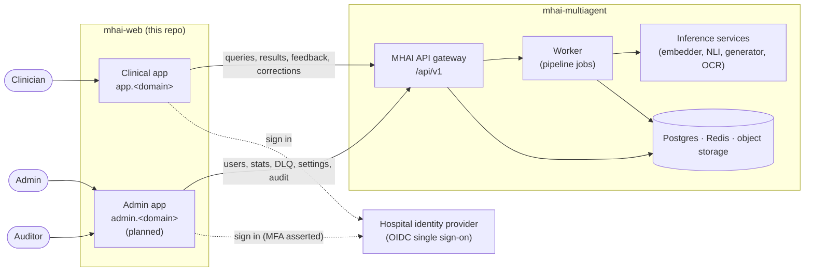
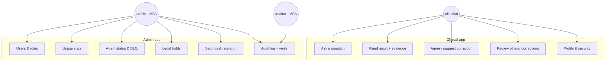
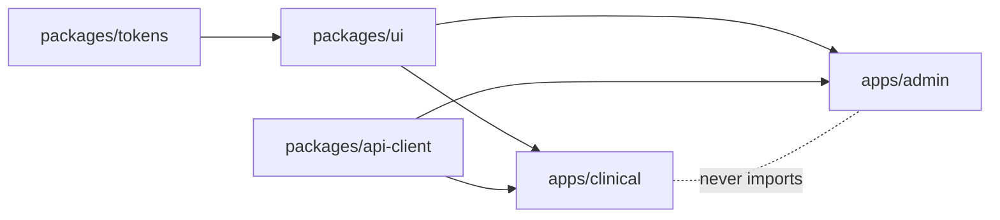
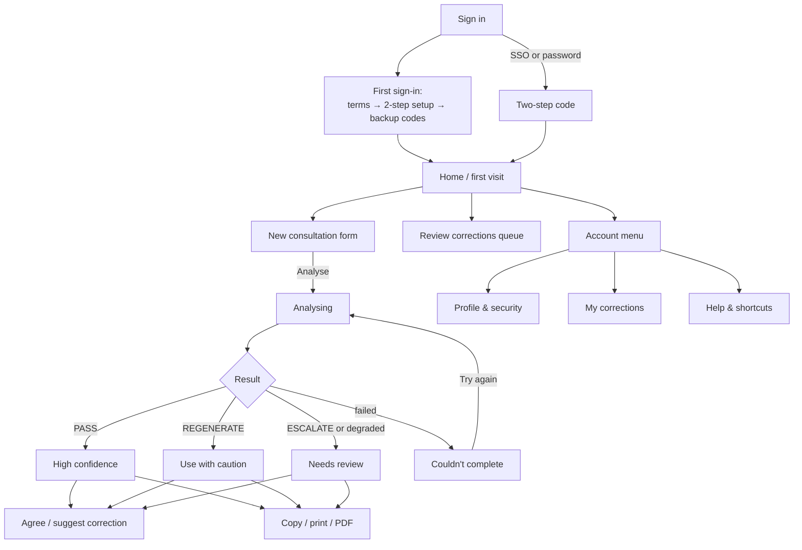
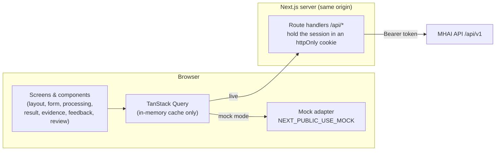
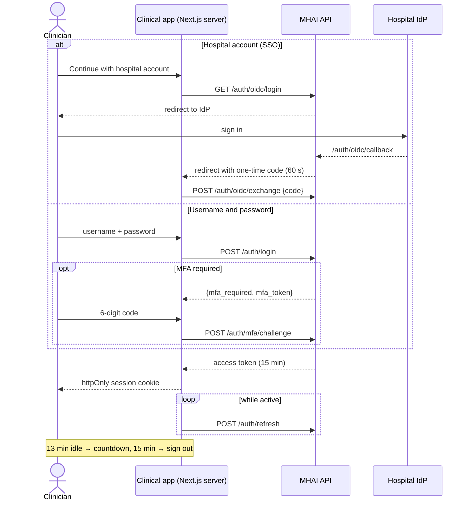
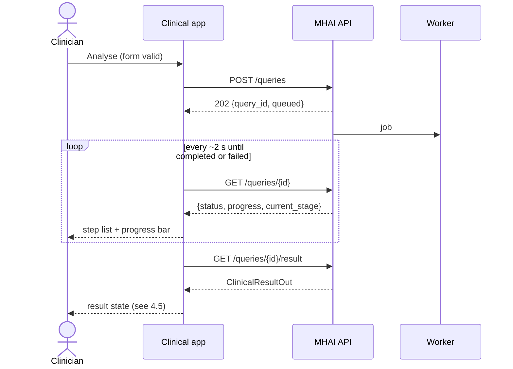
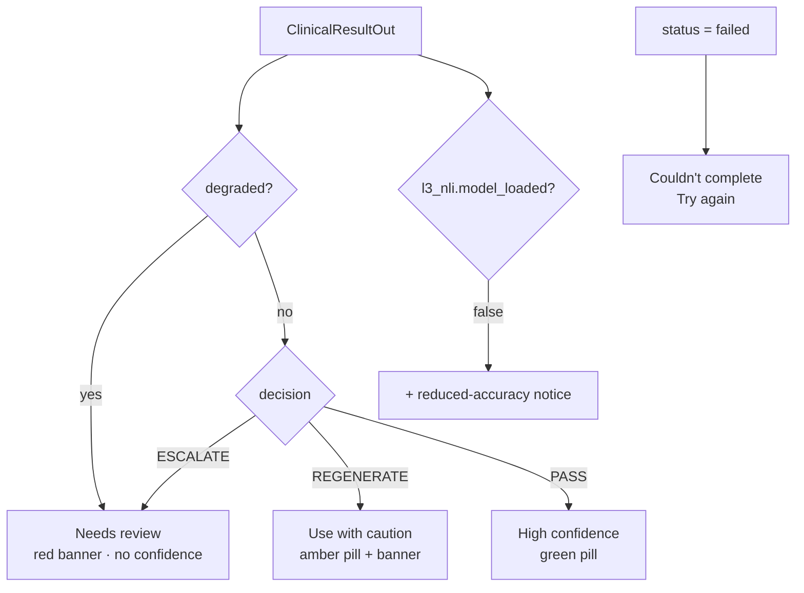
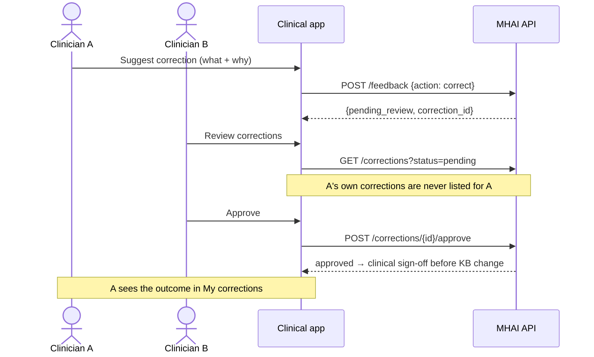
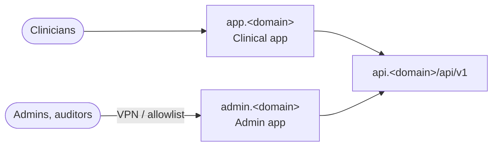

# Architecture

MHAI has **two frontend apps**. Both talk only to the MHAI API
(`Measured-Health/mhai-multiagent`, base path `/api/v1`).

| App              | Who uses it         | What it does                                                                                               | Status                                                                  |
| ---------------- | ------------------- | ---------------------------------------------------------------------------------------------------------- | ----------------------------------------------------------------------- |
| **Clinical app** | Clinicians          | Ask clinical questions, read evidence-checked results, give feedback, review other clinicians' corrections | This repo, Phase 1                                                      |
| **Admin app**    | Admins and auditors | Manage users, system health, failed jobs, legal holds, settings, audit log                                 | Planned ([ADR 0002](docs/adr/0002-separate-clinical-and-admin-apps.md)) |

The split follows the backend's security model. An admin account has **no
clinical permissions**: it can't submit queries, see patient data or give
feedback. A clinician has **no admin permissions**. The apps are kept
apart so neither can reach the other's screens, code or session.

## 1. System context



The same picture as a sketch:

```text
   Clinician                         Admin / Auditor
       │                                    │
       ▼                                    ▼
┌──────────────────┐              ┌──────────────────┐
│   CLINICAL APP   │              │    ADMIN APP     │
│ app.<domain>     │              │ admin.<domain>   │
│                  │              │ (VPN / allowlist)│
│ ask · results ·  │              │ users · health · │
│ feedback ·       │              │ DLQ · holds ·    │
│ review queue     │              │ settings · audit │
└────────┬─────────┘              └────────┬─────────┘
         │  clinician token                │  admin/auditor token (MFA)
         └───────────────┬─────────────────┘
                         ▼
               ┌───────────────────┐
               │  MHAI API /api/v1 │  checks role on every route
               └─────────┬─────────┘
                         ▼
          worker · inference services · data stores
```

## 2. Who can do what

This mirrors the API's RBAC matrix (mhai-multiagent spec §5.4). The UI
hides what a role can't do, but **the API is the enforcement point**.



- A **clinician** signing in to the admin app gets a 403 page, and an
  **admin** signing in to the clinical app does too. Each 403 page links
  to the right app.
- **Researcher** has no endpoints yet, so it has no app.

## 3. Repository layout

**Today (Phase 1):** this repo is one Next.js app, and it is the
clinical app.

```text
mhai-web/
├── app/                 Next.js App Router (clinical app)
├── design/              approved designs (v2 mockup, v3 boards, brand assets)
├── docs/adr/            decisions
├── docs/specs/          design specs
└── ARCHITECTURE.md
```

**When admin work starts** (ADR 0002), the repo becomes npm workspaces. The
apps are deployed separately but share packages.

```text
mhai-web/
├── apps/
│   ├── clinical/        today's app/ moves here
│   └── admin/
├── packages/
│   ├── ui/              shared components (buttons, cards, dialogs, tables)
│   ├── tokens/          colours, type, radius, shadows (design v3)
│   └── api-client/      types generated from the backend's openapi.json
└── design/ · docs/
```



Neither app imports from the other. Shared code lives only in `packages/`.

## 4. Clinical app

### 4.1 Screen map

The full designs are in `design/v3/`, and the spec is
`docs/specs/2026-10-13-ui-design-v3.md`.



Wireframe of the desktop layout:

```text
┌────────────┬──────────────────────────────────────┬──────────────────┐
│ [M] logo   │ Chest pain, 54 M   URGENT  [▣ panel] │ Evidence & safety│
│ + New      ├──────────────────────────────────────┤                  │
│ ⌕ ⌘K       │  ICD-10 I20.0      ▂▃▅▇ High conf.   │ Safety checks    │
│ ⇄ Review 3 │  Unstable angina                     │  ✓ ✓ ✓           │
│            │  summary…                            │ Why this conf.   │
│ TODAY      │  • step  [✓ AHA 2021]                │  ▬▬▬▬▬▬▬ 92%     │
│ ♥ Chest…   │  • step  [ⓘ needs review]            │ Sources          │
│ ◐ Febrile… │                                      │  ┌────────────┐  │
│            │  [I agree] [Suggest correction] [⧉▾] │  │ AHA 2021 ✓ │  │
│ DR Reyes   │  Completed in 11.8 s                 │  └────────────┘  │
│ ⌂ Hospital │                                      │                  │
└────────────┴──────────────────────────────────────┴──────────────────┘
  256 px              flexible                          330 px
  tablet: 76 px rail · portrait: panel → bottom sheet · mobile: drawer + sheets
```

### 4.2 Inside the app



- **Session:** the Next.js server keeps the API token in an `httpOnly`,
  `Secure`, `SameSite=Strict` cookie and forwards calls to the API. Browser
  JavaScript never sees the token (ADR 0001: "keeping tokens server-side").
- **Types:** generated from the backend's committed `openapi.json`, never
  written by hand.
- **Mock mode:** the same client interface, backed by four example
  results (PASS, REGENERATE, ESCALATE, FAILED). This lets the UI be built
  before the API is live.
- **No patient data in storage:** the query cache is memory-only, and so
  are drafts and session history. Nothing goes in `localStorage`,
  IndexedDB or a service-worker cache. Sign-out and the idle timeout clear
  memory.

### 4.3 Signing in



### 4.4 Asking a question



### 4.5 Which result state to show



Citation tags follow `Citation.action`: PASS shows a green "verified" tag,
FLAG an amber "needs review" tag, and REDACT a red "removed" tag with the
text struck through.

### 4.6 Corrections need two clinicians



Rejecting with a reason, withdrawing, and the "My corrections" list need
new endpoints. They're listed in the design spec §10.

## 5. Admin app (planned)

**Scope** comes from the backend's admin endpoints (API spec §4.1, §11).
Every admin action is audited.

| Area                              | Endpoints                                         | Who            |
| --------------------------------- | ------------------------------------------------- | -------------- |
| Users and roles                   | `GET/POST/PATCH /admin/users`                     | admin          |
| Usage stats                       | `GET /hga/stats`                                  | admin          |
| Agent status and queues           | `GET /agents/status`, `/admin/dlq`, retry, cancel | admin          |
| Feedback buffer reset             | `POST /admin/feedback-buffer/reset`               | admin          |
| Legal holds                       | `PUT/DELETE /admin/legal-holds`                   | admin          |
| Settings (retention, triage gate) | `GET/PATCH /admin/settings`                       | admin          |
| Audit log and integrity check     | `GET /security/audit`, `/security/audit/verify`   | auditor, admin |

```text
┌────────────┬─────────────────────────────────────────────────────┐
│ [M] Admin  │ System health                          ● All good   │
│            ├─────────────────────────────────────────────────────┤
│ ◉ Health   │ ┌─────────┐ ┌─────────┐ ┌─────────┐ ┌─────────┐     │
│ ☺ Users    │ │ Queue 3 │ │ DLQ 0   │ │ p95 14s │ │ Workers │     │
│ ▤ Stats    │ └─────────┘ └─────────┘ └─────────┘ └─────────┘     │
│ ⚑ Holds    │ Decision mix (PASS / REGENERATE / ESCALATE) ▇▅▂     │
│ ⚙ Settings │ Recent failed jobs …                    [Retry]     │
│ ⛨ Audit    │                                                     │
│ AD admin   │                                                     │
└────────────┴─────────────────────────────────────────────────────┘
```

**Rules:**

- MFA is required for admin and auditor. A single sign-on login must
  carry the IdP's MFA assertion.
- Served from its own origin (`admin.<domain>`), ideally reachable only
  over VPN or an IP allowlist. Its cookie is scoped to that origin, and
  it has its own CSP.
- **It never shows patient data.** Admin endpoints return ids and counts
  only.
- It uses the same design tokens and components as the clinical app.
  Its layout is denser, and it uses tables and charts.

## 6. Deployment



Each app is its own Next.js build and container, so they can be released
and rolled back on their own.

## 7. Cross-cutting rules

These are in CONTRIBUTING.md and apply to both apps:

- plain-language wording, never backend terms;
- an escalated or degraded result always shows the review banner;
- no patient data in logs, storage or analytics;
- API types are generated, never handwritten;
- the client never sends user ids;
- confidence is never shown by colour alone;
- keyboard and screen-reader support;
- `prefers-reduced-motion` is respected.
