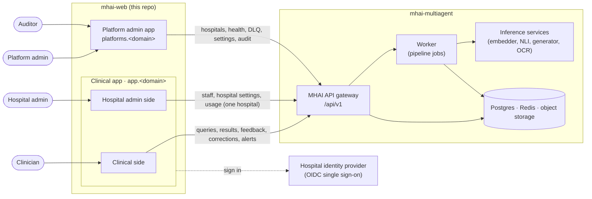
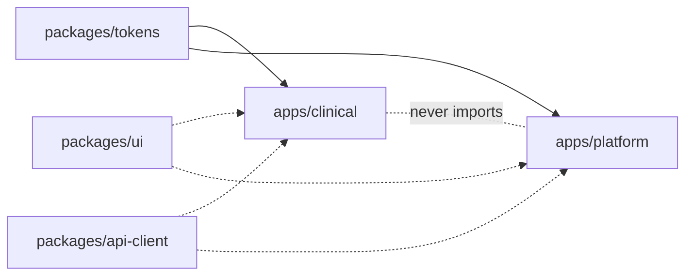
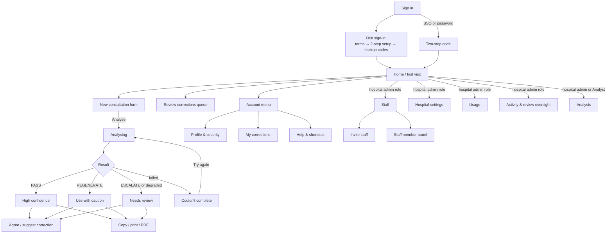
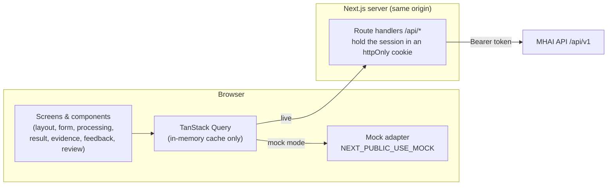
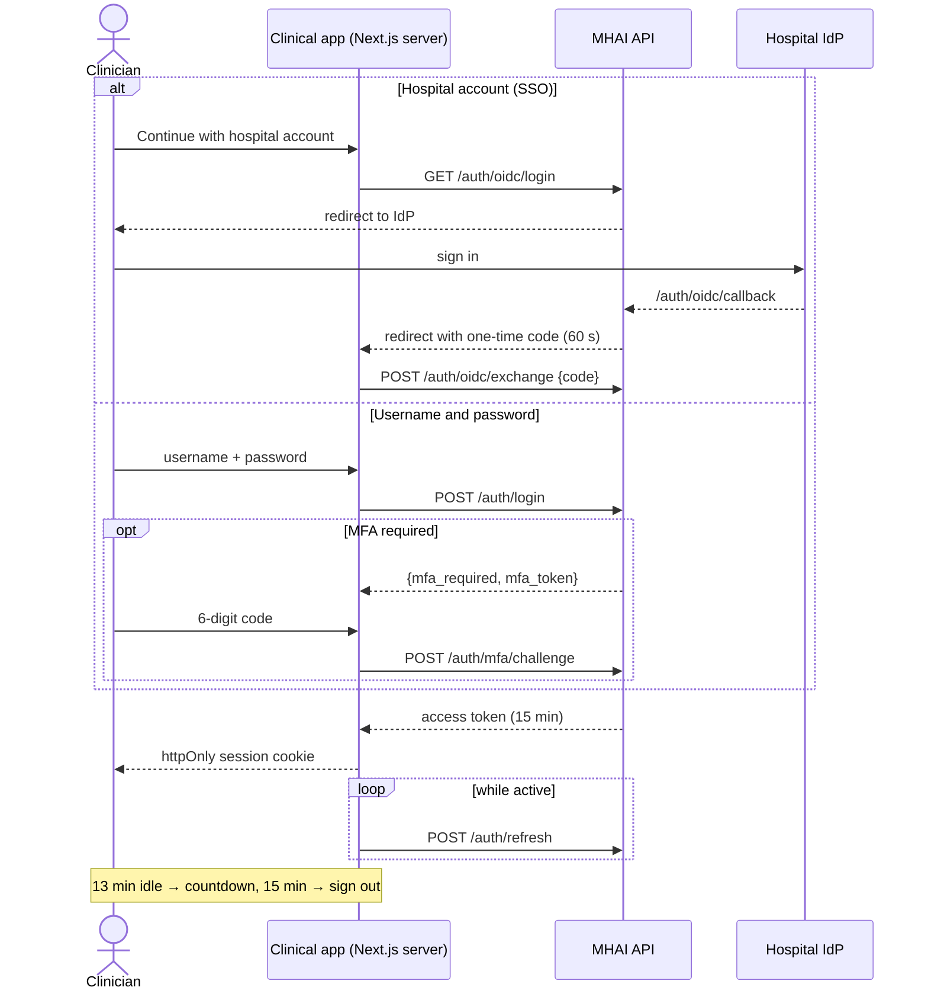
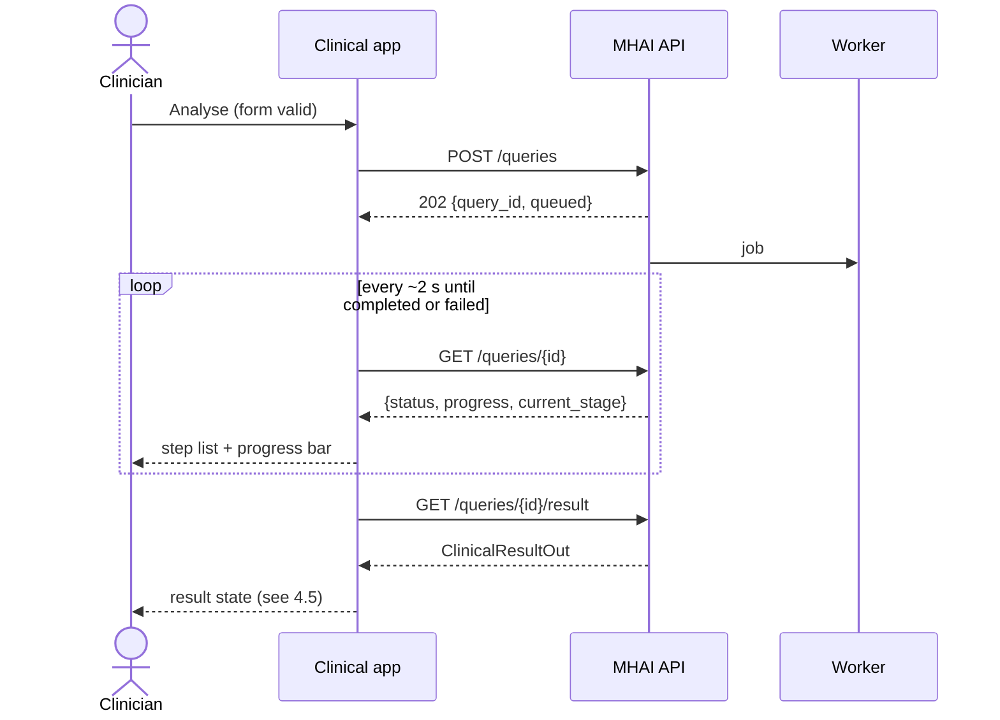
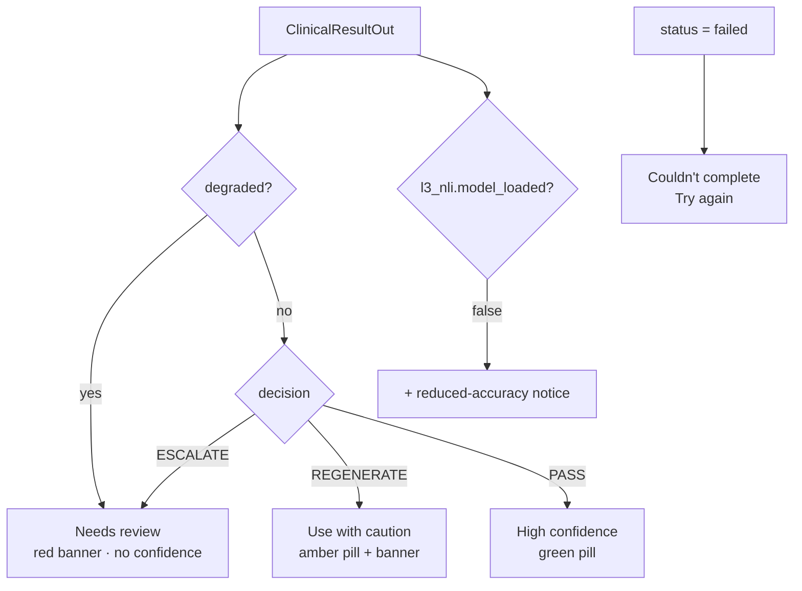
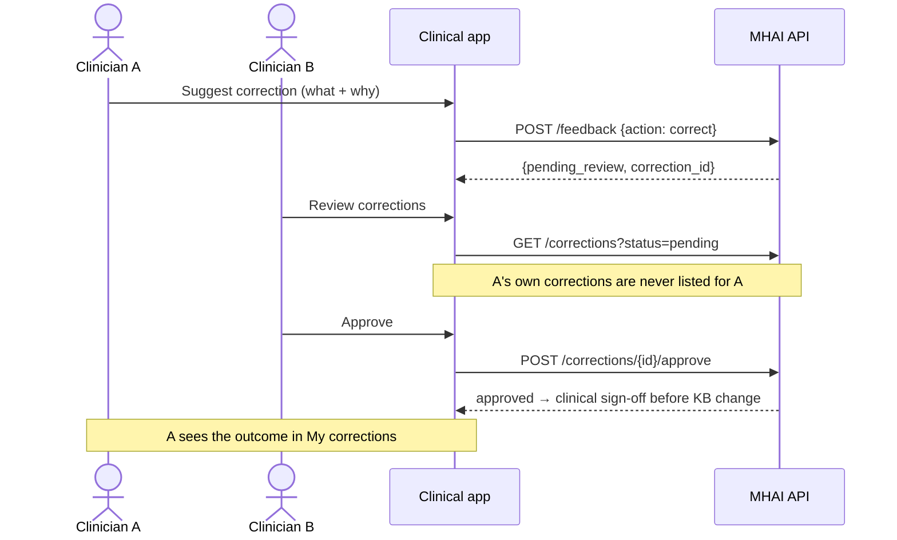
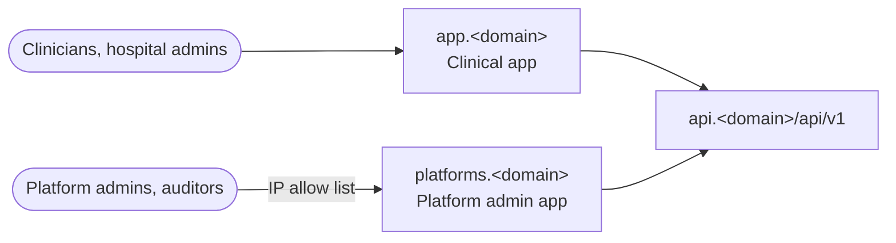

# Architecture

MHAI has **two frontend apps** and **three kinds of user**. Both apps talk
only to the MHAI API (`Measured-Health/mhai-multiagent`, base path
`/api/v1`).

| App                    | Who uses it                                         | What it does                                                                                                                                                                                               | Status                                                                                    |
| ---------------------- | --------------------------------------------------- | ---------------------------------------------------------------------------------------------------------------------------------------------------------------------------------------------------------- | ----------------------------------------------------------------------------------------- |
| **Clinical app**       | Clinicians, and hospital admins                     | **Clinical side:** ask questions, read evidence-checked results, give feedback, review corrections. **Hospital admin side:** manage the hospital's own staff, settings and usage                           | This repo, Phase 1                                                                        |
| **Platform admin app** | Measured Health staff: platform admins and auditors | Run the service: hospitals (add, deactivate, two-person removal, single sign-on), the platform team and its activity, analytics across hospitals, legal holds, system health and failed jobs, and settings | This repo, on sample data ([ADR 0002](docs/adr/0002-separate-clinical-and-admin-apps.md)) |

The three kinds of user:

- **Clinician:** works with patients' clinical questions.
- **Hospital admin:** runs **one hospital** (for example a medical director
  or the hospital's IT lead). They invite and manage staff, set hospital
  rules, and see usage counts. A person can be both clinician and hospital
  admin. The hospital admin role alone gives **no access to consultations
  or patient data**.
- **Platform admin / auditor:** Measured Health operations. They see
  every hospital, but never clinical content. They have **no clinical
  permissions**, which matches the backend's model, so they get their own
  app on their own origin.

## 1. System context



The same picture as a sketch:

```text
 Clinician      Hospital admin               Platform admin / Auditor
     │                │                      (Measured Health staff)
     ▼                ▼                                 │
┌─────────────────────────────────┐                     ▼
│          CLINICAL APP           │          ┌──────────────────────┐
│          app.<domain>           │          │  PLATFORM ADMIN APP  │
│ ┌──────────────┬──────────────┐ │          │  platforms.<domain>  │
│ │ CLINICAL     │ HOSPITAL     │ │          │  (IP allow list)     │
│ │ ask · result │ ADMIN        │ │          │ hospitals · health · │
│ │ feedback ·   │ staff ·      │ │          │ DLQ · holds ·        │
│ │ review queue │ settings ·   │ │          │ settings · audit     │
│ │              │ usage        │ │          │                      │
│ └──────────────┴──────────────┘ │          └──────────┬───────────┘
│  one hospital only (tenant)     │                     │ MFA always
└────────────────┬────────────────┘                     │
                 └──────────────┬───────────────────────┘
                                ▼
                      ┌───────────────────┐
                      │  MHAI API /api/v1 │  checks role + hospital
                      └─────────┬─────────┘  on every route
                                ▼
                 worker · inference services · data stores
```

## 2. Who can do what

The UI hides what a role can't do, but **the API is the enforcement
point**. The hospital admin role and hospital scoping are backend
additions (see the design spec §10).

```mermaid
flowchart TB
    subgraph C["Clinical app: clinical side"]
        c1[Ask a question]
        c2[Read result + evidence]
        c3[Agree / suggest correction]
        c4[Review others' corrections]
        c5[Profile & security]
    end
    subgraph H["Clinical app: hospital admin side"]
        h1[Staff: invite, roles, specialty, deactivate]
        h2[Reset a member's password / 2-step]
        h3[Hospital settings: review rules, 2-step, timeout]
        h4[Usage counts for the hospital]
        h5[Activity log & review oversight]
        h6[Alert settings: units, what to flag, who hears]
    end
    subgraph A["Platform admin app"]
        a0[Hospitals & SSO setup]
        a2[Record connections]
        a1[Platform users & roles]
        a3[Agent status & DLQ]
        a4[Legal holds]
        a5[Platform settings & retention]
        a6[Audit log + verify]
    end
    clinician((clinician)) --> c1 & c2 & c3 & c4 & c5
    hadmin((hospital admin · MFA)) --> h1 & h2 & h3 & h4 & h5 & h6
    hadmin --> c5
    admin((platform admin · MFA)) --> a0 & a2 & a1 & a3 & a4 & a5 & a6
    auditor((auditor · MFA)) --> a2 & a6
```



- **Roles combine in the clinical app:** a clinician who is also a
  hospital admin sees both sides in one sidebar. The "Hospital admin"
  group only appears with that role.
- **A hospital admin who isn't a clinician** signs in straight to the
  hospital admin side (Staff). Clinical screens redirect them there, and
  the server refuses them every clinical call.
- **Every hospital admin has two-step on:** one who signs in without it
  must set it up before reaching any page, and the server refuses the
  hospital admin calls until it is on.
- **Hospital admins are scoped to their hospital:** every staff and
  usage call is filtered by the hospital in the session. The hospital
  admin side never shows question text, results or patient details.
- **Wrong-app 403s:** only a platform account (platform admin or
  auditor) signing in to this app gets the 403 page, which says to use
  the platform admin app, with no link. Hospital admins use the hospital
  admin side here; a clinician or hospital admin signing in to the
  platform admin app is told "This account can't use the platform admin
  app." and signed out.
- **Analysis is gated, and is for two kinds of person:** hospital
  admins, and clinicians with the **Analyst** role (a hospital admin
  grants it in Staff; it needs Clinician), each for their own hospital
  only, and both need two-step. The page, its sidebar entries and its API
  paths exist only when `canUseAnalysis(user)` is true: always in the
  demo; in live mode only when the API's user says `features.analysis` and
  the server's `ANALYSIS_SIGNED_OFF` is exactly `true` (the proxy checks it
  on every call and answers 404 `not_found` otherwise). Platform accounts
  never see it.
- **Named access is gated twice.** `canUseNamedAccess(user)` is
  `canUseAnalysis(user)` and `features.named`: always in the demo; in live
  mode only when the API's `named_access` flag is on and the server's
  `NAMED_ACCESS_SIGNED_OFF` is exactly `true`. With the key off the proxy
  answers `hospital/clearances*`, `analysis/named-access` and
  `analysis/clearance/me` with 404 before reading the session, and refuses a
  named patient list with 403 `named_access_off`. The backend switch (Off,
  Letters only, On) stays the authority; the app only reads it. The Named
  access entry is in the Hospital admin group after Analysis and shows only
  to a hospital admin who passes the gate (`canOpenNamedAccess`).
- **Two abilities were added with the EMR screens.** A platform admin
  manages record connections (add, edit, test, switch on and off, each
  change but testing with their own two-step code); an auditor reads them
  and the proxy refuses their writes. A hospital admin edits the hospital's
  alert settings (no extra code); a clinician sees only their own alerts.
- **Researcher** has no endpoints yet, so it has no app.

## 3. Repository layout

The repo is npm workspaces. The apps are deployed separately but share
packages.

```text
mhai-web/
├── apps/
│   ├── clinical/        the clinical app (@mhai/clinical)
│   └── platform/        the platform admin app (@mhai/platform)
├── packages/
│   ├── tokens/          colours, type, radius, shadows (design v3)
│   ├── ui/              shared components (@mhai/ui)
│   └── api-client/      shared API, session and two-step helpers
│                        (@mhai/api-client)
├── scripts/             bundle check and repo tests
├── design/              approved designs (v2 mockup, v3 boards, brand assets)
├── docs/                adr/ decisions, specs/ design specs, plans/
└── ARCHITECTURE.md
```



Neither app imports from the other. Shared code lives only in `packages/`.
Two checks keep it that way:

- an ESLint rule blocks imports between `apps/clinical` and `apps/platform`;
- `npm run check:bundle` scans the clinical build for the platform marker,
  so platform code cannot ship to clinicians.

## 4. Clinical app

### 4.1 Screen map

The full designs are in `design/v3/`, and the spec is
`docs/specs/2026-10-13-ui-design-v3.md`.



Wireframe of the desktop layout:

```text
┌────────────┬──────────────────────────────────────┬──────────────────┐
│ [M] logo   │ Chest pain, 54 M   URGENT  [▣ panel] │ Evidence & safety│
│ + New      ├──────────────────────────────────────┤                  │
│ ⌕ ⌘K       │  ICD-10 I20.0      ▂▃▅▇ High conf.   │ Safety checks    │
│ ⇄ Review 3 │  Unstable angina                     │  ✓ ✓ ✓           │
│            │  summary…                            │ Why this conf.   │
│ TODAY      │  • step  [✓ AHA 2021]                │  ▬▬▬▬▬▬▬ 92%     │
│ ♥ Chest…   │  • step  [ⓘ needs review]            │ Sources          │
│ ◐ Febrile… │                                      │  ┌────────────┐  │
│            │  [I agree] [Suggest correction] [⧉▾] │  │ AHA 2021 ✓ │  │
│ DR Reyes   │  Completed in 11.8 s                 │  └────────────┘  │
│ ⌂ Hospital │                                      │                  │
└────────────┴──────────────────────────────────────┴──────────────────┘
  256 px              flexible                          330 px
  tablet: 76 px rail · portrait: panel → bottom sheet · mobile: drawer + sheets
```

### 4.2 Inside the app



- **Session:** the Next.js server keeps the API token in an `httpOnly`,
  `Secure`, `SameSite=Strict` cookie and forwards calls to the API. Browser
  JavaScript never sees the token (ADR 0001: "keeping tokens server-side").
- **Types:** generated from the backend's committed `openapi.json`, never
  written by hand.
- **Mock mode:** the same client interface, backed by four example
  results (PASS, REGENERATE, ESCALATE, FAILED). This lets the UI be built
  before the API is live.
- **No patient data in storage:** the query cache is memory-only, and so
  are drafts and session history. Nothing goes in `localStorage`,
  IndexedDB or a service-worker cache, except the encrypted offline outbox
  of unsent questions and feedback (see CONTRIBUTING). Sign-out and the
  idle timeout clear memory.

### 4.3 Signing in



### 4.4 Asking a question



### 4.5 Which result state to show



Citation tags follow `Citation.action`: PASS shows a green "verified" tag,
FLAG an amber "needs review" tag, and REDACT a red "removed" tag with the
text struck through.

### 4.6 Corrections need two clinicians



Rejecting with a reason, withdrawing, "My corrections", your recent
decisions and the feedback stats use an assumed contract until the backend
defines them (design spec §10 item 1). After Approve, the reviewer has 10
seconds to undo; the approval is sent when that window ends or when they
leave the page, whichever comes first.

### 4.7 Hospital admin side

Designs: `design/v3/hospital-admin.html`.

Routes: `/admin/staff`, `/admin/settings`, `/admin/usage`,
`/admin/activity` and `/admin/activity/oversight`. The calls go through the
same-origin proxy to `/api/v1/hospital/*`, which forwards only the exact
shapes the admin client uses, and only for a session with the hospital
admin role and two-step on (otherwise 403 `mfa_required`). Removing a
person sends the admin's own two-step code in the `DELETE` body. Until the
backend defines them, the calls follow the assumed contract in the design
spec §10 item 3.

| Screen             | What it does                                                                                                                                                                                                                                                                                                                                                                                   |
| ------------------ | ---------------------------------------------------------------------------------------------------------------------------------------------------------------------------------------------------------------------------------------------------------------------------------------------------------------------------------------------------------------------------------------------- |
| Staff              | Everyone at the hospital: roles, specialty, status, sign-in method, last active. Filters surface problems such as "Two-step not set up"                                                                                                                                                                                                                                                        |
| Invite staff       | One person or a pasted list, with a role and a specialty. With hospital single sign-on they just sign in; otherwise they get an email invite (7 days) and go through first sign-in                                                                                                                                                                                                             |
| Staff member panel | Change roles and specialty, set who can review corrections, send a password reset, reset two-step, deactivate, remove (needs the admin's own two-step code). You can't remove your own admin role                                                                                                                                                                                              |
| Hospital settings  | Review turnaround and reviewer rules, two-step policy for clinicians, idle timeout, "trust this device", and SSO status (read-only; Measured Health configures it)                                                                                                                                                                                                                             |
| Usage              | Counts only: consultations, active clinicians, the confidence mix, agreement rate, review time and specialty breakdown. CSV export                                                                                                                                                                                                                                                             |
| Alert settings     | `/admin/alerts`: the records connection's status (state, source labels and last update only), then three sections saved one at a time: units covered, what to flag (a level per kind of result) and who gets alerts (the hospital queue, named clinicians). A stale version reads "Changed by someone else"; saving with no queue and nobody named is refused. Each save is one Activity event |
| Activity           | A log of sign-ins, consultations (specialty and confidence only), feedback, review decisions, account changes and flagged security events; plus review oversight: overdue corrections, reviewer coverage, remind, assign a reviewer                                                                                                                                                            |

```text
┌────────────┬──────────────────────────────────────────────────────┐
│ [M] logo   │ Staff · Havana Hospital                [＋ Invite]   │
│ + New      ├──────────────────────────────────────────────────────┤
│ ⇄ Review 3 │ ⌕ search   All 48 · Active 44 · Invited 2 · ⚠ 1      │
│ HOSPITAL   │ NAME          ROLES             SPECIALTY  STATUS    │
│ ADMIN      │ Dr. Reyes     Clinician·Admin   Int. Med   Active    │
│ ☺ Staff    │ Dr. Mensah    Clinician         Cardiology ⚠ 2-step  │──► member panel
│ ⚙ Settings │ Dr. Adeyemi   Clinician         Paeds      Invited   │
│ ≋ Activity │ …                                                    │
│ ▤ Usage    │                                                      │
│ TODAY …    │                                                      │
│ DR Reyes   │                                                      │
└────────────┴──────────────────────────────────────────────────────┘
```

Every hospital admin action is written to the audit log with the actor
and the hospital.

### 4.8 Notifications and patient alerts

Spec: `docs/specs/2026-10-17-notifications-design.md`. Clinicians only.

- **One bell** in the top bar: new patient alerts plus decisions on your
  corrections, in one count. Its panel shows the latest of both and "See
  all".
- **Routes:** `/notifications` (Patient alerts: New, Handled, Dismissed,
  severity and, with more than one connected system, source) and
  `/notifications/corrections` (decisions on your corrections).
- **Calls:** through the same-origin proxy to `/api/v1/alerts*` and
  `/api/v1/me/notification-settings`, exactly the shapes the alerts client
  uses, for clinicians only. Until the backend defines them, they follow the
  assumed contract in the UI design spec
  (`docs/specs/2026-10-13-ui-design-v3.md`) §10 item 20 and the
  notifications design §9. A 409 `already_handled` keeps only who and
  when.
- **Pop-ups:** the first check after sign-in is a baseline. Critical always
  pops up (assertive live region); Urgent, Info and decisions follow the two
  switches in Profile & security → Notifications.
- **Routing and evidence:** each alert says who it was sent to (`routing`:
  "For you" and/or "Hospital queue"; missing means for you) and can carry
  up to three pieces of evidence under each likely cause. A queue-only
  Urgent or Info alert counts on the bell and lists under Hospital queue but
  does not pop up; a queue-only Critical one does. The alert list can filter
  by "Sent to". Alerts never go to patients.
- **EMR-agnostic** ([ADR 0003](docs/adr/0003-many-emr-systems.md)): the
  frontend never talks to an EMR, names a vendor or builds a record link; it
  follows the backend's `emr_link` ("Open patient record") and shows the
  hospital's `source_label`.
- **Privacy:** patient names and MRNs stay in memory (query cache, React
  state, pop-ups), never in storage or the URL, and clear on sign-out. "Ask
  MHAI about it" copies no identifiers into the consultation.

### 4.9 Analysis

Route: `/analysis`, outside `/admin` because analysts are not admins.
Sidebar: a hospital admin sees it once, in the "Hospital admin" group after
Usage ("Conditions and trends"); an analyst who is not an admin sees it under
Review. The calls go through the same-origin proxy to `/api/v1/analysis/*`
(GET only, the exact shapes the client uses). Five views (Prevalence and
trends, Who is affected, Co-occurring conditions, Findings and alerts, MHAI
quality) share one set of filters held in React state; nothing goes in the
URL, the title or storage. Every count is read under the small-group rule
(`lib/analysis/guards.ts`): a value the server should have hidden fails that
view closed. **See patients** opens a de-identified list (level 1) that is
never exported or kept, and each opening is logged in the hospital's
activity. Sample data only; it needs clinical, privacy and legal sign-off
before live use (see the README).

### 4.10 Named access

Route: `/admin/named-access`, in the Hospital admin group after Analysis
("Clearance letters"). It lists the hospital's clearance letters (a table
from `md`, cards below), with the server's `today` and `max_end_date`, and
opens one in a side panel (a sheet on a phone) to view, revoke, remove a
person or renew; **Upload a letter** is a dialog (a sheet on a phone). The
open letter is held in React state, never the URL. Writes take the admin's
two-step code and an `Idempotency-Key`; a revoke sends the letter's
`version`. A letter's pages are fetched one at a time through the proxy
(`image/png` or `image/jpeg` only, `no-store`), held as a Blob in component
state and shown through an object URL that is revoked when the page changes
or the viewer closes. Nothing about a letter reaches storage, a cache or the
URL. A person's Staff panel shows their named access, worked out from the
letter list, and warns before a change that would end it; when the letters
fail to load it says "Couldn't load named access" with **Try again**.

## 5. Platform admin app

`apps/platform` (`@mhai/platform`) is for Measured Health staff: platform
admins and auditors. It runs on sample data until the backend has the
platform endpoints; the contract it assumes is in
[the platform admin spec, §13](docs/specs/2026-10-17-platform-admin-design.md).

| Page        | What it does                                                                                                                                                                                                                                                                                               | Who                            |
| ----------- | ---------------------------------------------------------------------------------------------------------------------------------------------------------------------------------------------------------------------------------------------------------------------------------------------------------- | ------------------------------ |
| Hospitals   | List, search, add a hospital and invite its first admin                                                                                                                                                                                                                                                    | platform admin (auditors read) |
| Hospital    | Details, deactivate and reactivate, single sign-on, two-person removal with retention and legal-hold checks, recent actions                                                                                                                                                                                | platform admin (auditors read) |
| Analytics   | What changed, the tabs and a CSV, in counts only; follow-ups                                                                                                                                                                                                                                               | platform admin (auditors read) |
| Connections | Every hospital's patient record connections with state filters (`?state=`), a connection's page (status, test, switch on and off, settings, last day's problems), and Add a connection. Credentials are write-only: "Set · {date}" or "Not set", never shown again; also a section on each hospital's page | platform admin (auditors read) |
| Legal holds | The holds list and filters, place a hold, a hold's page with edit and two-person lift and undo; also a section on each hospital's page                                                                                                                                                                     | platform admin (auditors read) |
| System      | Health (overall, parts, times, errors; refreshes every 30 s) and Failed jobs (retry, cancel with a code), in counts only                                                                                                                                                                                   | platform admin (auditors read) |
| Settings    | Retention periods (longer at once, shorter with a preview and a second admin), triage on and off, clearing unapproved learning data, pause clean-up, and the changes waiting for approval                                                                                                                  | platform admin (auditors read) |
| Team        | Invite, change role, remove (never your own row)                                                                                                                                                                                                                                                           | platform admin (auditors read) |
| Activity    | Every platform action, newest first, by hospital                                                                                                                                                                                                                                                           | both                           |
| Audit log   | Every entry in the log newest first, named access, exports, and the integrity check; reads are recorded                                                                                                                                                                                                    | both                           |
| Account     | Password, backup codes, signed-in devices                                                                                                                                                                                                                                                                  | both                           |

When the service is having problems, a warning with **View health** shows on every page except Health itself.

```text
browser ──> platforms.<domain> (IP allow list)
              Next.js: pages + /api/auth/* + /api/v1/[...path] proxy
                 │  sealed httpOnly cookie holds the platform token
                 ▼
            api.<domain>/api/v1/platform/*   (X-MHAI-Audience: platform)
```

**Rules:**

- **Two-step always.** Every platform account signs in with a two-step
  code; there is no skip and no "trust this device". Deactivate,
  reactivate, request or approve removal, and removing a team member also
  need the person's own code at the time.
- **15-minute idle limit**, on the screen and on the server: a warning at
  13 minutes, signed out at 15.
- **The proxy allows only the calls the app makes:** exact methods and
  paths, opaque ids, writes only from the app's own pages, and auditors
  never write (403). The token never reaches browser JavaScript.
- **It never shows patient data**, and keeps nothing in browser storage.
- **Its own origin** (`platforms.<domain>`), behind an IP allow list, with
  its own cookie and a strict CSP with a fresh nonce on every page.
- **Shared look, separate code:** the same tokens and `@mhai/ui`
  components as the clinical app, a "Platform" label beside the logo, a
  `bloom` page header, tables on desktop and cards on phones. It never
  imports from the clinical app.

## 6. Deployment



Each app is its own Next.js build and container, so they can be released
and rolled back on their own.

## 7. Cross-cutting rules

These are in CONTRIBUTING.md and apply to both apps:

- plain-language wording, never backend terms;
- an escalated or degraded result always shows the review banner;
- no patient data in logs, storage or analytics;
- API types are generated, never handwritten;
- the client never sends user ids;
- confidence is never shown by colour alone;
- keyboard and screen-reader support;
- `prefers-reduced-motion` is respected.
